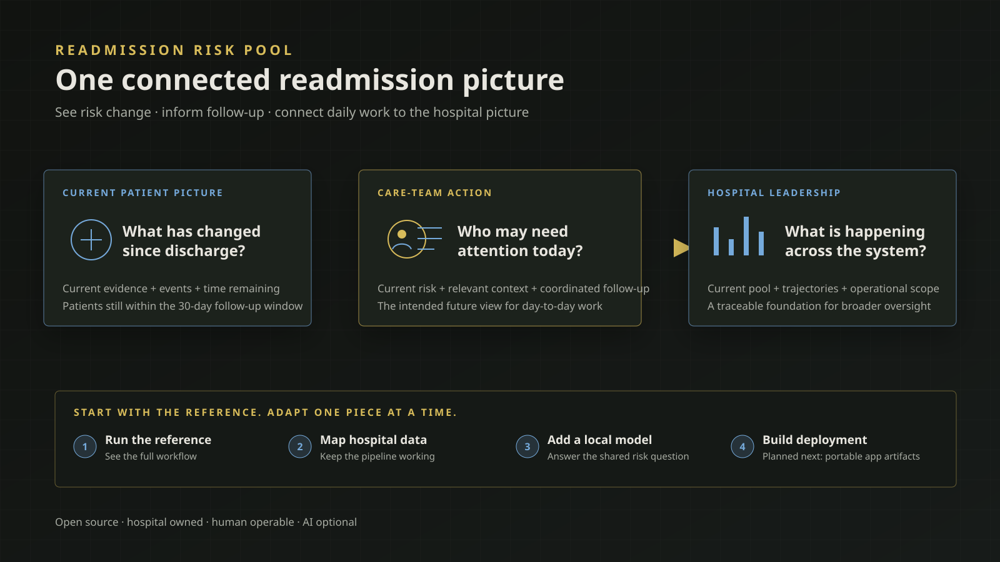

::: {.project-hero}

Open-source hospital readmission management · Active development

# Readmission Risk Pool Platform

A hospital-controlled platform for understanding who remains at risk after discharge, how that risk changes over time, and how a current patient-level picture can support more connected readmission work.

  <a class="lab-button lab-button-primary" href="https://github.com/centralstatz/readmission-risk-pool-platform">Follow 1.0 development</a>
  <a class="lab-button lab-button-secondary" href="https://github.com/centralstatz/readmit">See the planned R interface</a>

:::

::: {.project-notebook}

::: {.notebook-preview}

{fig-alt="Concept diagram connecting a current patient picture to care-team action and hospital leadership insight, followed by four incremental adoption steps"}

Project-direction diagram · intended practical value, not a current clinical interface

:::

::: {.notebook-grid}

::: {.notebook-main}

## The problem this is trying to solve

Hospitals often begin follow-up with a readmission score calculated around discharge. But the patient's situation does not stop changing when that score is produced. Appointments happen or are missed. New barriers emerge. The patient may be readmitted, die, or simply move closer to the end of the follow-up period. A static score can quickly stop describing the decision in front of the care team.

At the same time, the information needed for follow-up is often spread across systems and teams. Care managers assemble a day-to-day picture, analysts maintain separate methods and reports, and quality or executive leaders review measures that may be delayed or disconnected from the work underneath them.

The **readmission risk pool** is the group of discharge episodes still within the follow-up window and not yet ended by readmission or death. Managing that pool means being able to answer a practical question repeatedly: given what is known now, who remains at risk, how has that picture changed, and what does the collective picture show?

This project began as a way to connect those views rather than treat them as separate problems. [Read the original 2024 article](https://www.zajichekstats.com/post/managing-the-readmission-risk-pool/).

## The practical idea

RRP is being built as a hospital-owned foundation for a connected readmission workflow.

- **Care-management teams** should eventually be able to work from a current picture instead of relying on a discharge-era score or reconstructing the story across disconnected tools.
- **Analysts and modelers** should be able to map approved local data and use a risk method that fits their hospital, while producing one clearly defined quantity the rest of the system can understand.
- **Quality and operational leaders** should be able to see patient-level changes roll into an attributable system picture rather than receive a separate metric with no visible connection to day-to-day work.

The current 1.0 development application establishes the analytical center of that idea: a Current Risk Pool, actual accepted risk trajectories over time, and a direct Overview of the selected operational scope. It does **not** yet provide a care-management queue, intervention workflow, clinical recommendations, or executive performance system. Those practical extensions must be designed deliberately from real operational needs rather than implied by the presence of a risk score.

:::

::: {.notebook-aside}

### Project state

**What it is**

An open-source platform in active 1.0 development for a hospital-controlled readmission-risk system.

**Working in development now**

Local installation, the `rrp` command-line interface, a complete fictional reference project, hospital-owned data and model boundaries, durable history, logical products, and a local supplied application.

**Stage**

Software validation and completion of the 1.0 product path—not clinical validation or production approval.

**Not available yet**

A published 1.0 release, public installation path, deployable product-only artifacts, independent-adopter qualification, or an approved production deployment.

**Next experiment**

Portable product-only deployment builds for Posit-compatible environments and OCI/Docker.

**Useful participation**

Feedback on the decisions, views, and working relationships a connected hospital readmission system should support.

:::

:::

## What is different about the 1.0 direction

The 1.0 line is a simpler product than the earlier public `v0.1.0` design.

There is now **one Readmission Risk Pool repository and one installed software product**. Hospitals will not install a separately generated “Hospital Implementation” repository. RRP itself will be built and released from the [main platform repository](https://github.com/centralstatz/readmission-risk-pool-platform). Once installed, it creates an independent, hospital-owned project containing only the local pieces the hospital is responsible for: how approved source data is interpreted, how it is mapped into the shared structure, which local risk method is used, and where hospital-owned state lives.

The primary human interface is also much clearer. A single `rrp` command is designed to handle software health, project setup and validation, analytical runs, history, products, and application launch. The underlying R packages still do the work, but operators should not need to manage package internals or repository scripts as their normal workflow.

Finally, 1.0 no longer treats “baseline risk” as a separate platform concept or product. A hospital may use an existing discharge score inside its own modeling method, but RRP asks every compatible method to return the same current quantity. That keeps the meaning stable even when hospitals choose different models.

## How a hospital is intended to use it

The planned adoption path starts with something inspectable and working, then moves local responsibility into place deliberately.

1. **Install RRP and run the fictional reference.** The current development build already proves this path locally. A future public release will make that the normal starting point rather than requiring a clone of the development repository.
2. **Inspect the whole workflow.** The fictional project uses the same project, history, product, and application boundaries intended for a real hospital. It provides a concrete way to evaluate the product before using hospital data or seeking broader operational approval.
3. **Initialize a hospital-owned project.** RRP creates a small editable project for local source mapping, risk calculation, branding, and configuration. It does not create another copy of the platform.
4. **Connect approved local data.** The hospital writes the narrow mapping from its own sources into RRP's shared structure. The rest of the platform can then operate without knowing the hospital's source-system details.
5. **Use an appropriate local risk method.** The hospital can begin with a transparent example, then select and validate a method that reflects its population, data, and readmission drivers while preserving the common risk meaning.
6. **Run, review, and deploy deliberately.** The CLI performs explicit risk runs, retains what the platform knew and produced at each point, builds application products, and launches the local application. Portable application deployment is the next development stage and is not available yet.

This is incremental adoption without parallel products: one installed platform, one hospital-owned project, and explicit replacement points.

## One current risk question

The statistical idea behind 1.0 is precise but practical. At a given moment after discharge, RRP asks for the patient's **remaining probability of a first readmission by 30 elapsed days after discharge**, given that the patient is alive and has not already been readmitted, using only information that was available at that moment.

In plain language: *given where this patient is now, what is the remaining chance of readmission before the follow-up window ends?*

That quantity naturally changes as time passes and new information becomes available. It also avoids comparing scores that appear similar but actually answer different questions. RRP defines the question; the hospital controls the method used to answer it. A local method might use survival analysis, machine learning, Bayesian methods, or an existing discharge score as one input. What matters to the platform is that the result has the same stated meaning and is produced from temporally valid information.

The current application shows accepted estimates that actually occurred. It does not invent daily values, carry a discharge estimate forward as “baseline,” or smooth a trajectory between observations.

## What the development build can demonstrate now

Although 1.0 is not released, its current development line has a tested end-to-end local path:

- a closed development distribution can be verified and installed into a private, versioned location;
- the `rrp` CLI can initialize and diagnose projects, run the fictional workflow, inspect history, build products, and launch the application;
- software versions can be installed side by side, explicitly activated, checked for project compatibility, rolled back, and safely removed without silently changing hospital project data;
- a hospital project can replace the fictional source mapping and risk provider through small, explicit local files;
- successful runs retain attributable history rather than silently rewriting earlier results;
- coherent application products can be rebuilt from that history; and
- the local supplied application presents the Current Risk Pool, actual episode trajectories, and direct scope summaries without reaching back into hospital sources or rerunning a model.

This is strong implementation evidence, but it is not a public 1.0 release or evidence of clinical effectiveness.

## Rigor in the background

The technical safeguards matter because they make the practical workflow more trustworthy, even when most users never need to inspect their details.

- Data, project, software, and model boundaries are validated so incompatible inputs can fail early and visibly.
- Analytical time is explicit, and the platform is designed to exclude information that was not yet available when a risk estimate was made.
- Operational history is attributable and append-oriented, with explicit correction behavior rather than silent replacement.
- Risk calculation, history, product refresh, and application launch are separate actions, preventing a dashboard visit from quietly changing analytical results.
- The CLI is the documented human path. Automation and future agents may call the same operations, but no AI system owns unique platform logic or is required to operate RRP.

The repository contains the detailed contracts, tests, architecture, and operator documentation for technical reviewers.

## Open source and hospital controlled

RRP is licensed under Apache-2.0. The intended public product does not require a proprietary platform license, CentralStatz service, private model, or AI agent to operate.

The platform supplies the common software, shared risk meaning, validation, history, products, application, and operating interface. The hospital retains responsibility for its data access and interpretation, source mapping, selected model and model evidence, infrastructure, security, privacy, monitoring, clinical governance, and operational adoption.

That boundary is central to the project: the hospital can start from a coherent working reference without surrendering control of the parts that must reflect its own environment.

## Where it stands today

The repository identifies the current product as `1.0.0-dev` and explicitly marks it **not released**. The installation and operator foundation is complete, including the CLI and a fully exercised fictional local path. The next planned work is to create closed product-only deployment artifacts so the application can move into an approved environment without carrying source connections, model code, or writable analytical history with it.

Independent-adopter testing, broader platform qualification, final release validation, and publication still follow. Until those steps are complete, RRP should be treated as active development—not software available for hospital use or patient care.

The longer-term vision remains larger than the current application: a connected view that can inform care-management work and make hospital-level oversight traceable to the patient-level analytical picture. Those workflow and leadership capabilities are direction, not claims about what the current 1.0 development build already provides.

## The planned role of `readmit`

The [`readmit`](https://github.com/centralstatz/readmit) R package is being repurposed as an optional R interface to RRP. That integration is not implemented yet.

Its intended role is to help R users work with supported RRP interfaces—for example, constructing, testing, or operating hospital model providers—without becoming the platform itself. RRP will remain usable without `readmit`, and `readmit` will not redefine the common risk question or replace the CLI.

## Participate

The most useful feedback now is both practical and methodological: what should a care-management team be able to understand each morning, what evidence would help analysts trust a changing risk estimate, and which summaries would help operational and executive leaders connect system performance to the work happening patient by patient?

- [Follow active 1.0 development](https://github.com/centralstatz/readmission-risk-pool-platform)
- [Review the planned `readmit` R interface](https://github.com/centralstatz/readmit)
- [Read the original practical framework](https://www.zajichekstats.com/post/managing-the-readmission-risk-pool/)
- [Discuss the project](mailto:alex@centralstatz.com?subject=Readmission%20Risk%20Pool%20Platform)

:::
