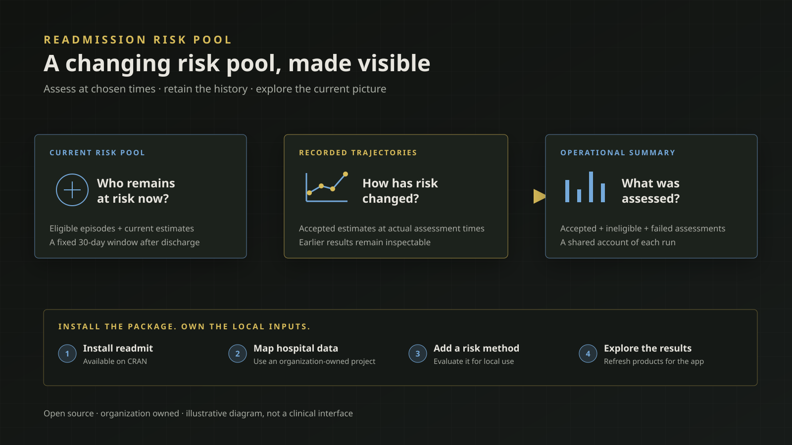

::: {.project-hero}

Open-source hospital readmission management · Available on CRAN

# Readmission Risk Pool Platform

Readmission risk changes after discharge. Readmission Risk Pool helps an organization reassess that risk over time, keep the history of what it knew, and explore the current picture in an application it owns.

  <a class="lab-button lab-button-primary" href="https://readmit.centralstatz.com/">Explore the RRP website</a>
  <a class="lab-button lab-button-secondary" href="https://CRAN.R-project.org/package=readmit">Get readmit on CRAN</a>

:::

::: {.project-notebook}

::: {.notebook-preview}

Explanatory diagram · the package website shows the real application with simulated data

:::

::: {.notebook-grid}

::: {.notebook-main}

## Why this exists

Hospitals may have a readmission score when a patient leaves, but that score cannot show what happens next. Time passes, new information arrives, and some patients are readmitted or die. A care team needs to know what the remaining risk looks like **now**, not only what it looked like at discharge.

The information is often fragmented, too. People doing follow-up may see one picture, analysts another, and quality or executive leaders a third. The long-term idea behind Readmission Risk Pool (RRP) is to connect those views so decisions about individual patients and the hospital-wide picture can be understood together.

I began exploring that idea several years ago. The [original 2024 article](https://www.zajichekstats.com/post/managing-the-readmission-risk-pool/) explains the practical problem that started it.

## What is available today

RRP is now implemented and distributed as the open-source [`readmit` R package](https://CRAN.R-project.org/package=readmit). Version 1.0.0 is the first major public release. Its [package website](https://readmit.centralstatz.com/) is the main place for setup instructions, the application preview, a simulated-hospital walkthrough, and technical reference material.

With `readmit`, an analyst or developer can create an ordinary project owned by their organization. The project includes places to connect local source data, provide a local risk method, and customize its Shiny application. At chosen times after discharge, RRP assesses eligible patients, saves the results, and prepares views of current remaining risk, recorded changes in risk, and a summary of the assessment.

This is a working analytical foundation. The supplied application lets a user explore the risk pool and recorded trajectories. It is not yet a care-management task list or a hospital executive reporting system; those broader uses remain questions for practical testing and local implementation.

:::

::: {.notebook-aside}

### Project state

**Available now**

`readmit` 1.0.0 on CRAN, a public package website, a project initializer, repeated assessments, retained history, derived views, and a project-owned application.

**Stage**

Validation of practical use and local methods. Package availability does not establish clinical validity or use in a hospital.

**What the organization supplies**

Its own data mapping, risk method, evaluation, and decisions about how results should affect care.

**Next useful test**

Review the working views with hospital analysts and care teams to learn what they can act on, what context is missing, and what needs validation.

**Useful participation**

Feedback on the risk question, the application views, and real follow-up workflows.

:::

:::

## A changing question, asked consistently

For a patient still in the 30-day follow-up period who has not had a known readmission or death, each assessment asks: *What is the remaining chance of a first readmission before 30 days have elapsed since the original discharge?*

Another assessment does not start a new 30-day clock. It uses information available at that assessment time and records the answer as it stood then. That matters when a new event becomes known later: the earlier assessment remains part of the history rather than being silently rewritten.

RRP supplies this shared question and the rules for who is eligible. The organization supplies the model or other method for producing the estimate. Different hospitals can use methods suited to their own data and patients without changing what the resulting probability means.

## From package to local project

The path is intentionally small enough to inspect before an organization commits to a larger implementation:

1. **Install `readmit` from CRAN and create a project.** The package gives the team an editable starting structure, including the application. The data and risk scripts begin as stubs; they do not pretend to be a working hospital model.
2. **Connect approved hospital data.** The organization maps its discharge and event information into RRP's shared structure, keeping source-system details under local control.
3. **Supply and evaluate a risk method.** The local method estimates the remaining chance of readmission for eligible patients. The package does not provide a clinically validated model.
4. **Assess, refresh, and explore.** Run assessments at chosen times, inspect the retained history, then refresh the application's views. The app reads those results; opening it does not calculate a new risk estimate.

The [getting-started guide](https://readmit.centralstatz.com/articles/getting-started.html) and [simulated-hospital walkthrough](https://readmit.centralstatz.com/articles/implementing-rrp.html) show the full path without requiring a hospital data connection.

## What the current views can and cannot say

The application presents the latest accepted risk estimates for eligible episodes and the estimates actually recorded for a selected episode over time. An operational summary accounts for the episodes assessed, including those with a known readmission, death, closed follow-up window, or a risk calculation that could not be completed.

That makes the analytical history inspectable. It does not by itself tell a care team whom to contact, what intervention to choose, or whether acting on a prediction will improve outcomes. Those decisions need local clinical judgment, workflow design, model evaluation, and governance.

The diagram above illustrates how current analytical views could eventually connect daily follow-up with leadership oversight. The [RRP website](https://readmit.centralstatz.com/) shows an actual application screenshot using simulated data and explains the current product in more detail.

## Open source, locally owned

`readmit` is free to install from CRAN and is released under the Apache-2.0 license. The organization owns its project, data connections, risk method, and application changes. The package provides a common analytical structure, while the hospital remains responsible for privacy, security, clinical validation, monitoring, and appropriate use.

The first release makes the idea available for hands-on evaluation. It is not evidence that a model is accurate for a particular hospital or that the platform has improved patient outcomes.

## Participate

What should someone doing readmission follow-up be able to understand each morning? Which changes in risk are meaningful, and what context would make the application trustworthy to an analyst or quality leader? Those are the most useful questions to bring to this project now.

- [Explore the RRP website and guides](https://readmit.centralstatz.com/)
- [Install `readmit` from CRAN](https://CRAN.R-project.org/package=readmit)
- [Browse the implementation on GitHub](https://github.com/centralstatz/readmit)
- [Read the original practical framework](https://www.zajichekstats.com/post/managing-the-readmission-risk-pool/)
- [Discuss the project](mailto:alex@centralstatz.com?subject=Readmission%20Risk%20Pool%20Platform)

:::
